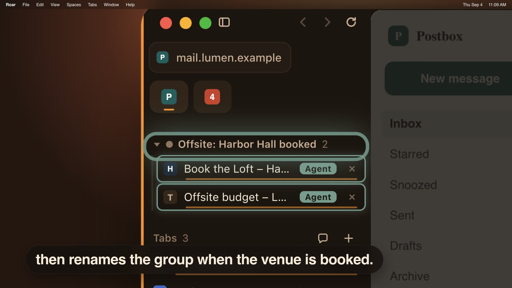

<p align="center">
  
</p>

<h1 align="center">Roar</h1>

<p align="center"><strong>Your AI agent, in your real browser.</strong></p>

<p align="center">
  Roar is a free, open-source browser for Mac (Apple Silicon and Intel). Claude, Cursor or Codex use it like you do,
  already logged in, in tabs you can watch and take over. It can ask you before it acts. One click cuts it off.
</p>

<p align="center">Try: <code>Open my inbox in Roar and summarize what's unread.</code></p>

<p align="center">
  <b>Download for macOS:</b> <a href="https://github.com/roarbrowser/roar/releases/latest"><b>Apple Silicon</b></a> (<code>Roar-&lt;version&gt;.dmg</code>)
  <br>Intel Macs: <code>Roar-&lt;version&gt;-intel.dmg</code> (from 1.3)
  <br><a href="https://roarbrowser.app/">Website</a> &nbsp;·&nbsp; Open source, MIT licensed
</p>

<br>

<p align="center">
  <a href="https://roarbrowser.app/media/roar-film-web.mp4"></a>
  <br><sub>▶ Watch the film: an agent works in Roar's sidebar and asks before it pays</sub>
</p>

| You get | Your agent gets |
|---|---|
| A vertical sidebar with spaces, each with its own logins | One command to connect: `claude mcp add roar …` |
| Split view, a command bar and Reader mode | Pages it opens appear as tabs you can watch or take over |
| Tabs that archive themselves when you stop using them | A way to ask you a question or ping you when it's done |
| Chrome extensions, with uBlock Origin Lite built in | Only the spaces you allow; ghost tabs are hidden from agents |
| Import from Arc, Chrome, Safari (Mac), Firefox, Edge or Dia | A Chromium-compatible browser, so sites work as in Chrome |

## Install

About five minutes. Needs macOS 13 or later; no Node.js.

**1. Download (1 min).** Get the latest `Roar-<version>.dmg` (Apple Silicon) or `Roar-<version>-intel.dmg` (Intel, from 1.3) from [Releases](https://github.com/roarbrowser/roar/releases/latest), open it and drag Roar onto Applications. Or:

```bash
brew install --cask roarbrowser/tap/roar
```

Windows builds are paused for 1.0.x, so releases carry no Windows files; when they return: on Windows, run `Roar-windows-x64-setup.exe` (or `-arm64-setup.exe`) to install Roar into Program Files with a Start menu entry, or unzip `Roar-windows-x64.zip` anywhere and run `Roar.exe` (portable, no install). Either way your data lives in `%APPDATA%\Roar`. Windows checks for updates with WinSparkle.

**2. First open.** Roar is signed with a Developer ID and notarized, so it opens like any app you download: macOS asks once whether to open it. Click **Open**.

**3. Connect your agent (1 min).** Roar's welcome page has a **Connect** button for Claude Code, Claude Desktop, Cursor, VS Code, Windsurf, Codex, Gemini CLI and others. Click yours and restart that app. The MCP server ships inside Roar and launches Roar if it isn't running (keep Allow agents to connect on).

<details>
<summary>Set it up by hand</summary>

The server is `/Applications/Roar.app/Contents/Resources/roar-mcp`, a stdio MCP server.

```bash
claude mcp add --scope user roar -- /Applications/Roar.app/Contents/Resources/roar-mcp     # Claude Code
codex mcp add roar -- /Applications/Roar.app/Contents/Resources/roar-mcp      # Codex
gemini mcp add roar /Applications/Roar.app/Contents/Resources/roar-mcp        # Gemini CLI
code --add-mcp '{"name":"roar","command":"/Applications/Roar.app/Contents/Resources/roar-mcp"}'  # VS Code
```

Claude Desktop (`~/Library/Application Support/Claude/claude_desktop_config.json`), Cursor (`~/.cursor/mcp.json`), Windsurf (`~/.codeium/windsurf/mcp_config.json`) and most other clients:

```json
{ "mcpServers": { "roar": { "command": "/Applications/Roar.app/Contents/Resources/roar-mcp" } } }
```
</details>

On first launch Roar offers to bring over your Arc spaces and pinned tabs. Updates arrive through Roar › **Check for Updates…**

### Uninstall

**Mac:** Roar › **Uninstall Roar…**, or, if Roar won't start, open **Uninstall Roar** from the DMG. Roar quits and goes to the Trash with its caches, logs and update settings, and its MCP server and session hooks come out of your agents' configs (each edited file is backed up as `<file>.roar-uninstall.bak`). **Keep my data** (on by default) keeps your logins, tabs and spaces in `~/Library/Application Support/Roar` for a later install; turn it off to trash those and the API keys saved for model chat too. A `brew` install can also use `brew uninstall --cask roar`, which removes only the app.

**Windows:** Settings › Apps › Roar › Uninstall. It asks whether to keep your data in `%APPDATA%\Roar`, and takes Roar out of agent configs the same way.

## Coming from Arc or Dia?

*A browser doesn't need a company behind it.*

The Browser Company [put Arc in maintenance mode in May 2025](https://browsercompany.substack.com/p/letter-to-arc-members-2025) to build Dia. Dia is closed source
with a built-in assistant.

Roar is the other answer. MIT licensed, so the code stays open: if I ever stop, anyone can fork it and keep it going. No built-in assistant;
bring the agent you already use and plug it in over MCP. Your spaces and pinned tabs come
over on first launch.

| In Arc | In Roar |
|---|---|
| Spaces with their own profiles | Spaces, each with its own logins (⌃1–⌃9) |
| Pinned tabs and folders | Pinned tabs and pinned groups, nested folders included |
| Tabs that archive themselves | The same, after 6h, 12h, 1 day or 1 week |
| Split view | Split view (⌘\\), or drag one tab onto another |
| Command bar | Command bar (⌘T), including the text of pages you've read |
| Closed source, in maintenance mode | Open source, MIT, shipping |

## Built for agents

Your agent, not ours. The bundled MCP server (`roar-mcp`, built on
[chrome-devtools-mcp](https://github.com/ChromeDevTools/chrome-devtools-mcp)) lets it open
pages, read them, click, fill forms, run scripts and take screenshots, and starts Roar if
needed. Settings > "Your AI agent drives Roar" picks where it works: this window, so you
watch (the default), or a hidden headless Roar with its own profile (`~/.roar-headless`,
port 9444) started on demand.

- **Agents can reach you.** Two extra tools put cards in the sidebar: `notify_user` (info,
  done, or needs-you, with an optional Open link) and `ask_user`, which shows buttons and hands
  your click back to the agent. Needs-you cards also raise a macOS notification and a Dock
  badge while Roar is in the background. Cards last for the session.
- **Your Claude Code sessions, live in the sidebar.** Turn on Settings > "Show my Claude Code
  sessions in the sidebar" (it adds a hook to `~/.claude/settings.json`). Every session shows its
  project, what it's doing and whether it needs you; click one running in tmux or cmux to open
  it in its own tab, as a chat or the live terminal, and reply, answer a prompt with 1/2/3, or
  press Esc or ⌃C. Others jump to their window. **Send tab** in that view sends a tab to the
  session's prompt (never ghost tabs); **Side by side** splits it beside your last web page. **New** starts a session in any folder. The hook reports the
  prompt, tool and state, never the conversation.
- **Slash commands in the reply box.** Type `/` in a session window's chat or terminal reply
  box to list the tool's built-in commands plus your own and the project's commands and skills;
  pick with the arrow keys and Tab or Enter.
- **Cards that mean it.** A done card shows the start of the agent's final reply. Needs-you
  cards appear for a permission prompt or a question, not for a session that is just idle.
- **Agent pages are real tabs.** `new_page` opens a tab in your active space's sidebar,
  not a stray window, so you can watch, take over, or close what the agent is doing.
- **Agents per profile.** Right-click a space (or use Settings) to allow or block agents in
  it. Blocked spaces and ghost tabs are hidden from CDP entirely, so agents can't list or
  attach to them; with several spaces allowed, the agent asks you which to use (or calls
  `use_profile`), and its new pages open there.
- **One click to cut it off.** The dot under the settings icon shows whether agents can
  reach the current space (hover for the port, connected agents and allowed spaces); click
  it to allow or block agents in this space. Settings > "Allow agents to connect" closes
  the CDP port entirely, without restarting.
- **Chromium-compatible.** Roar is built on Chromium, so sites that support Chrome generally
  work in Roar too. Use it on sites whose terms allow automated access.
- **Also scriptable:** AppleScript (`open url`, `execute javascript`, `get URL of every tab`)
  and raw CDP on `127.0.0.1:9222` (extra instances start at 9333).

## For browsing

**Tabs that stay tidy**
- A vertical sidebar with pinned tabs (⌘D), pinned groups and tab groups; drag to reorder.
- Each tab has a thin bar that shrinks while you ignore it; when it runs out the tab moves to
  Archived (after 6h, 12h, 1 day or 1 week, or never). ⇧⌘K archives now, ⇧⌘T brings one back.
- ⌃Tab switches tabs most recently used first; ⌘1–⌘9 jumps straight to one.
- A speaker on tabs playing audio; click it to mute.

**Spaces and privacy**
- Spaces keep separate tabs and a separate profile (logins, cookies, extensions): ⌃1–⌃9 or ⇧⌘[ ⇧⌘].
- Ghost tabs (⇧⌘N) use a throwaway profile per session. Roar deletes it when the last ghost tab
  closes; if that fails (or Roar quits first), it is deleted on the next launch. Until then it sits
  in the data dir, so ghost tabs are not a guarantee against someone with access to your Mac.
- Copy Link Address unwraps Outlook Safe Links and `.mcas.ms` wrappers.
- uBlock Origin Lite is built in; other Chrome extensions install as usual.

**Getting around**
- One command bar (⌘T, ⌘L) for addresses, search, open tabs, history and the text of pages
  you've visited. Type `>` for commands.
- Split view (⌘\\), or drag a tab onto another: left half for side by side, right half for top and bottom.
- Reader mode (⌥⌘R), find in page (⌘F), per-site zoom, swipe back and forward.
- Picture-in-picture for video (⇧⌘P), or float any tab in a mini window (⇧⌘F).
- New windows (⌘N) start with your spaces and pinned tabs.

**Small things that add up**
- Copy any page as Markdown (⇧⌘C) or save it to Downloads.
- Unread Gmail in the sidebar, with Read, Move and Delete per message.
- Your open GitHub pull requests as a live folder (via `gh`).
- Sign-in popups open as sidebar tabs, not stray windows.
- A history page (⌘Y) with search and a day-by-day view; Reopen All Tabs from Last Session.

<details>
<summary><b>Keyboard shortcuts</b></summary>

| Shortcut | Action |
|---|---|
| ⌘T / ⌘L | Command bar: new tab / current tab |
| ⌘N / ⇧⌘N | New window / ghost tab |
| ⌘D | Pin tab |
| ⇧⌘K / ⇧⌘T | Archive tabs now / reopen archived tab |
| ⌃Tab / ⌃⇧Tab | Next / previous tab, most recent first |
| ⌘1–⌘9 | Jump to tab |
| ⌃1–⌃9, ⇧⌘[ / ⇧⌘] | Switch space |
| ⌘\\ | Split view |
| ⌥⌘R | Reader mode |
| ⇧⌘C | Copy page as Markdown |
| ⇧⌘P / ⇧⌘F | Picture-in-picture / float tab |
| ⌘F, ⌘G / ⇧⌘G | Find, next / previous |
| ⌘+ / ⌘− / ⌘0 | Zoom |
| ⌘Y / ⇧⌘J | History / downloads |
| ⌥⌘B / ⌥⌘I | Toggle sidebar / DevTools |

</details>

## Network & privacy

Roar has no account or server of its own and its code sends no analytics. Update checks and downloads
go to GitHub, which sees your IP address under GitHub's privacy statement; the project sees only
aggregate download counts. These are the connections Roar's own code makes that we know of (Chromium's are below):

- **Updates:** Sparkle checks `raw.githubusercontent.com/roarbrowser/roar/main/appcast.xml`
  (the Intel and Windows builds use their own appcasts) and downloads new releases from GitHub.
  Checks send no system profile; GitHub sees your IP address and Roar's version, as with any download.
- **Search:** what you type in the command bar or new tab goes to your search engine
  (DuckDuckGo by default; changeable in Settings). Web search for the chat uses DuckDuckGo's
  HTML page from a throwaway profile.
- **AI providers:** only the ones you set up: an API with your key (for example `api.openai.com`,
  `api.anthropic.com`), a local server on `localhost`, or an AI command-line tool you have installed
  and signed in to (such as Claude Code), which sends your messages, and any page text you include,
  to that tool's own service under its own terms.
- **Gmail in the sidebar (on by default):** Roar checks each space's unread Gmail
  (`mail.google.com/mail/u/<n>/feed/atom`, up to 6 accounts) with that space's own Google cookies,
  at launch and every few minutes. Turn it off in Settings > Sidebar modules.
- **Outlook in the sidebar (on by default):** when a space is signed in to Outlook, Roar loads
  `outlook.cloud.microsoft` in a hidden page with that space's cookies to list unread inbox mail.
  Turn it off in Settings > Sidebar modules.
- **GitHub pull requests folder (on by default when the gh CLI is installed):** Roar runs
  `gh api search/issues` with your `gh` login at launch and every 10 minutes.
- **Savanna (easter egg):** opening it reads your GitHub login through `gh` and loads your public
  contributions calendar from `github.com`.
- **Page text index (on by default):** to search pages you've visited, Roar keeps their text in its
  data folder on your computer (not from ghost tabs). Nothing is sent anywhere; turn it off in Settings > Privacy.
- **AI agents:** any agent you connect (through Roar's MCP server or the debugging port) can see and
  act on the pages in spaces you allow agents in, signed in as you, and what it reads goes to that
  agent's AI provider. Ghost tabs are hidden from agents. Turn a space's agent access off by clicking
  its dot in the sidebar. The agent port is on by default; turn it off in Settings > Agents if you
  don't use agents. On Apple Silicon the port refuses clients without this launch's token;
  the Intel build gets that protection in 1.4, so until then any app running as you can reach it there. You are responsible for what agents you connect do in your accounts; Roar is
  provided as is, without warranty, under the MIT License.
- **Dictation:** the speech model is downloaded from Hugging Face the first time you use it.
- **uBlock Origin Lite:** ships with its filter rules built in; Roar fetches no lists for it.
- **AI sites in the sidebar:** the sites you open there (for example `chatgpt.com`, `claude.ai`,
  `gemini.google.com`, `perplexity.ai`, `grok.com`, `chat.mistral.ai`, `copilot.microsoft.com`)
  load like any web page, with that space's cookies.
- **Chrome Web Store:** `chromewebstore.google.com`, only when you open it to install or update an extension.

Roar is built on Chromium (via CEF) and does not turn off Chromium's own background networking,
so Chromium components may still make requests of their own (for example to
check for extension updates or component updates); these background services stay
enabled. Widevine (DRM video) is enabled and Chromium may download its module when a site asks for it.
Roar identifies itself to sites as Chrome-compatible: its client hints name the "Google Chrome" brand,
like its user agent, and it turns off the `navigator.webdriver` automation flag Chromium sets.
These are compatibility settings, not permission to ignore a site's terms; follow each site's rules on automated access.
It is not a "zero outbound connections" browser. This list comes from reading Roar's source,
not from a network capture.

## For developers

<details>
<summary><b>Build from source</b></summary>

```bash
./scripts/build.sh                       # fetches CEF into third_party/, builds, signs (Developer ID or Apple Development identity if present, else ad-hoc)
open build/src/Release/Roar.app
./scripts/update-cef.sh                  # move to the newest stable CEF/Chromium and rebuild (--check to only report)
```

Needs macOS, Xcode, `cmake` and `ninja`. Environment overrides:

- `ROAR_CDP_PORT` (default `9222`): DevTools Protocol port; setting it also forces the port on.
  The port is on by default; Settings > "Allow agents to connect" opens or closes it while
  Roar runs.
- `ROAR_DATA_DIR` (default `~/Library/Application Support/Roar`): profile and `state.json`.
- `--load-extension=<dir>`: load an unpacked Chrome extension. It loads into every Space's profile, alongside the bundled uBlock Origin Lite.

</details>

<details>
<summary><b>How it works</b></summary>


CEF binds a Chrome-style window to the first Chrome-style BrowserView it hosts, so
Roar uses a frameless Alloy shell window for the sidebar and one frameless Chrome-style
window per tab, attached as a macOS child window over the content area. The command bar
and toast are small Alloy child windows. Chrome style on tabs is what keeps extensions,
DevTools and CDP working. See `src/controller.h`.

The UI is HTML in `resources/ui`, served from `roar://ui/`, and talks to C++ through the
CEF message router (`window.roarQuery`). Web pages may only send `extract.result` or `index.result` with a
nonce Roar issued to that tab.

</details>

## Known limits

- Page-text search stores page text unencrypted in the data dir (mode 0600). Turn it off in Settings, or clear it with "Forget saved text" there ("Forget saved page text" in the command bar).
- H.264 and AAC need a CEF built with proprietary codecs. The stock CEF that `scripts/build.sh` fetches plays WebM, VP9 and AV1 but not many `.mp4` sources;
  `scripts/build-cef-codecs.sh` builds one that does, with Roar's Chromium patches (hours for a first build; the checkout needs well over 100 GB).
  Releases since 1.0.1 ship this build, configured to decode H.264 and AAC with macOS's built-in video and audio decoders (VideoToolbox and AudioToolbox), with no FFmpeg H.264 or AAC decoder and no OpenH264; the release codec gate verifies that against the framework's dSYM.
  HEVC (H.265): through 0.37.14, Roar's CEF kept Chromium's HEVC parser and decoded HEVC video through macOS VideoToolbox (Roar bundles no HEVC decoder). Since 1.0.1 the shipped CEF is built with `enable_hevc_parser_and_hw_decoder=false`, so it has no HEVC parser or hardware decode path and does not play HEVC video.
  H.264 therefore needs a Mac whose VideoToolbox can decode it (progressive 8-bit 4:2:0 Baseline, Main or High; not interlaced, High 10, 4:2:2 or 4:4:4), and a VideoToolbox failure is no longer retried in software. AAC Main and LTP do not play, WebCodecs `AudioDecoder` needs a `description` for AAC, and `AudioContext.decodeAudioData()` cannot decode AAC even though `canPlayType()` reports AAC support.
  The Windows builds use stock CEF without H.264 or AAC.
- The tab sound indicator follows `<audio>` and `<video>` elements on the page itself, not Web Audio or media inside cross-origin iframes.
- Markdown extraction and Reader mode cover HTML pages; PDFs and Google Docs canvases are not handled.
- The first AppleScript call triggers a macOS Automation
  prompt.

## Contributing

The source is right here. Issues and pull requests welcome. Build with `./scripts/build.sh`
before sending a change; UI-only edits reach the app bundle only through that script.

## Source code for open-source components

Roar bundles FFmpeg (LGPL-2.1, built into the CEF framework), uBlock Origin Lite (GPLv3), and in
`roar-mcp` the Bun runtime with JavaScriptCore (LGPL-2) and TinyCC (LGPL-2.1). The written offer in the
notices covers these and the complete CEF/Chromium source of each release.
Each [GitHub release](https://github.com/roarbrowser/roar/releases) attaches the exact source
for that version: `ffmpeg-<rev>.tar.gz`, `uBOL-home-<version>.tar.gz`, the uBO Lite zip and
`roar-cef-patches.tar.gz`. For `roar-mcp` the offer is the complete source (the `mcp/` directory at the release's git tag, MIT), the exact Bun version and the build command, so it can be rebuilt against a modified Bun or JavaScriptCore. For at least three years after a version's release, the source is
also available on request from roarbrowser@gmail.com at no more than the cost of distribution.
The full notices and this written offer ship in `Roar.app/Contents/Resources/THIRD_PARTY_NOTICES.txt`.
Roar 0.37.14 is no longer offered for download, but its written offer still runs: its source (the `v0.37.14` tree, its CEF patches and FFmpeg revision) is kept and sent on request. For its complete notices, see [legal/roar-0.37.14-notices-supplement.md](legal/roar-0.37.14-notices-supplement.md).

## License

Roar is released under the [MIT License](LICENSE). Chrome, Google, Arc, Dia, Safari, Apple, macOS, Claude, Anthropic, Cursor, Codex, ChatGPT, OpenAI, Ollama, uBlock Origin and other product names are trademarks of their owners;
Roar is not affiliated with or endorsed by them and names them only to say what it works with. The build fetches third-party code
that keeps its own license, including [CEF](https://bitbucket.org/chromiumembedded/cef)/Chromium (BSD and others),
FFmpeg (LGPL-2.1), [uBlock Origin Lite](https://github.com/uBlockOrigin/uBOL-home) (GPLv3), and
Bun/JavaScriptCore (MIT/LGPL-2) in roar-mcp; see THIRD_PARTY_NOTICES.txt.
